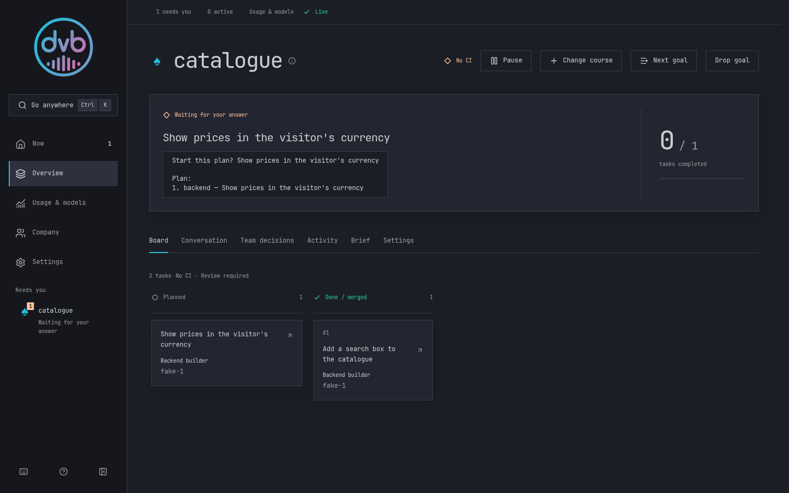
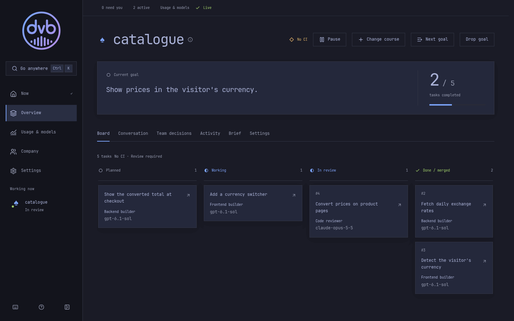
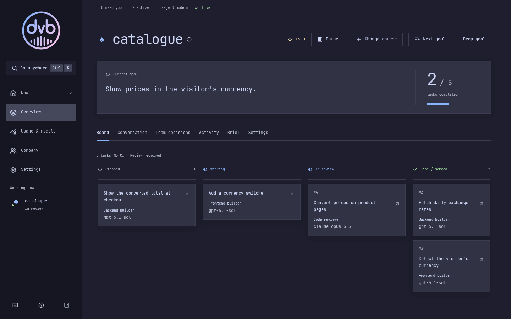
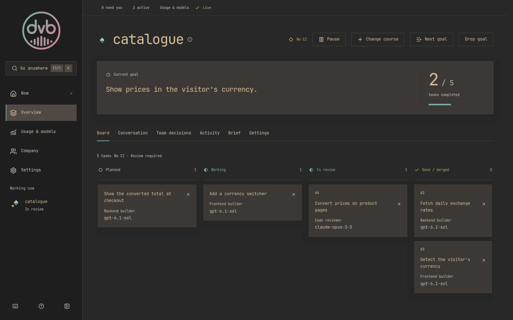

# dvb

A team of AI coding agents that runs on your own Linux PC and works on your
GitHub repositories; on Omarchy it follows your desktop theme
([see it](#omarchy-themes)).

You write a goal in a sentence or two. An AI orchestrator turns it into a plan
and asks you to approve it. AI builders (Claude Code or Codex) then write the
code, one pull request per task. AI reviewers check each pull request, and dvb
merges it when the checks pass. You follow along and answer questions from the
command line or the desktop app.



**You need:**

- Arch Linux or Omarchy on x86_64, with sudo (or pkexec).
- A GitHub account, or an organization you administer.
- A Claude subscription for Claude Code. A Codex subscription is optional.
  Runs use your subscription's limits. A Codex-only setup also works
  ([details](docs/install.md#requirements-in-detail)).
- Room to work: a run starts only while 10 GiB of memory and 25 GiB of disk are
  free ([details](docs/install.md#requirements-in-detail)).

There is no hosted service. Everything runs on your machine, and you need no
account with the dvb authors.

> **dvb merges its own work.** It merges pull requests that only its AI
> reviewers have checked. It also adds a rule to the default branch that
> blocks direct pushes, including yours. Try it on a new repository first
> ([what it changes on GitHub](docs/install.md#costs-and-github-effects)).

**Status:** pre-1.0. Commands, settings and the app may change between releases.

## Quick start

This takes you from nothing to a first merged pull request. It works on a
personal account and on GitHub's free plan. Below, `<you>` is your GitHub login
or organization.

**1. Install.** This installs the engine (a system service) and the desktop app:

```sh
curl -fsSL https://github.com/broken-branch/dvb/releases/latest/download/install.sh -o install.sh
sudo sh install.sh --engine --cockpit
```

Without sudo, run `pkexec sh "$PWD/install.sh" --engine --cockpit`. The
installer checks the release's signature and checksums before writing dvb's files
([check the installer yourself](#check-a-release)).

**2. Make a test repository.** On GitHub, create a public repository named
`catalogue`, with a README.

**3. Connect GitHub.** dvb works through a private GitHub App that you own.
This creates it:

```sh
dvb github connect --owner <you> --repos catalogue
```

Open the one link it prints first in a browser on this machine, then click
**Create GitHub App** on GitHub. The browser returns through the dvb desktop app
and opens GitHub's installation page automatically. If it doesn't, open the
install link printed by the command. Choose **Only select repositories**, pick
`catalogue`, then click **Install**. If you left out `catalogue`, follow the
printed `Give the App access to …` link to add it. The command ends with
`Connected to <you>; repositories: …`. If it says your git name or
email is missing, set them with `git config --global user.name "Your Name"` and
`git config --global user.email "you@example.com"`, then run it again.

**4. Log in to Claude.** Run `dvb login claude`, open the link, sign in and paste
the code the page shows at the terminal's `Code:` prompt. If you use Codex too,
run `dvb login codex`, open the link, sign in and enter the device code printed
by the command on that page. These logins belong to dvb and are separate from
your own `claude` and `codex` logins; `dvb doctor` shows anything setup still needs.

**5. Add the project and state a goal.**

```sh
dvb project add catalogue --repo <you>/catalogue --no-ci
dvb goal catalogue "Make a one-page catalogue of five books, with a search box"
```

`--no-ci` tells dvb that the repository has no CI checks yet. `dvb goal`
prints the goal's id.

**6. Approve the plan.** Planning takes a few minutes:

```sh
dvb wait <goal-id> --until plan
dvb answer <question-id> <n>
```

`dvb wait` prints the plan question, its task list and numbered answer options.
The `<question-id>` is after `Question` on the first line. Read the plan, then
answer with the number of the option that approves it. The option numbers can
differ from question to question.

**7. Wait for the merge.**

```sh
dvb wait <goal-id>
```

When the goal is done, it prints `Merged PR #<n> …` for each merged pull request.
If it returns earlier, answer any question with `dvb answer <question-id> <n>`
or follow the printed retry or resume command, then run `dvb wait <goal-id>`
again ([when something is stuck](#when-something-is-stuck)). Open the repository
on GitHub to see the result.

Prefer clicking? `dvb app` opens the desktop app. Its setup wizard does steps
3 and 4. Open the plan question in **Needs you**, select the option that approves
it, then click **Send answer**.

## Words dvb uses

- **Project**: one GitHub repository that dvb works on.
- **Goal**: what you want done, in a sentence or two.
- **Plan**: the goal split into tasks. Task work starts after you approve it.
- **Task**: one piece of the plan. A completed task ends as one merged pull
  request; dropped tasks do not.
- **Run**: one Claude Code or Codex session working on a task, in its own
  isolated systemd unit and checkout. Orchestrators and reviewers have runs too.
- **Question**: something dvb needs from you, with numbered options. Open
  questions and failed or stopped tasks that still need attention make up
  **Needs you**; dropped or superseded work no longer counts.
- **Role** and **hire**: a role is a job on the project's team (the
  orchestrator, a builder such as `backend`, a reviewer). A hire is the model
  and effort that role runs on.
- **Engine**: the system service that keeps dvb's state and talks to GitHub.
  **Cockpit**: the local web app served by the desktop service, opened in
  Chromium with `dvb app` and connected to the engine.

## Omarchy themes

On Omarchy, the app follows your desktop theme by default (Settings → Colour
theme → "Auto / follow Omarchy"). Switching the Omarchy theme recolours dvb right
away, without a reload. It also ships palettes named after Omarchy's themes,
which you can pick there.

Omarchy users can add the [bar widget](https://github.com/broken-branch/omarchy-dvb#readme) with
`omarchy plugin add https://github.com/broken-branch/omarchy-dvb --enable`.

<table>
  <tr>
    <td width="33%" align="center">
      <a href="docs/themes/tokyo-night.png"></a><br>
      Tokyo Night
    </td>
    <td width="33%" align="center">
      <a href="docs/themes/catppuccin.png"></a><br>
      Catppuccin
    </td>
    <td width="33%" align="center">
      <a href="docs/themes/gruvbox.png"></a><br>
      Gruvbox
    </td>
  </tr>
</table>

## Check a release

Releases are signed with minisign. The public key is the second line of
[release.pub](crates/dvb-engine/src/update/release.pub). With minisign installed,
check the installer before you run it:

```sh
u=https://github.com/broken-branch/dvb/releases/latest/download
curl -fsSL --remote-name-all $u/install.sh $u/SHA256SUMS $u/SHA256SUMS.minisig
key=$(curl -fsSL https://raw.githubusercontent.com/broken-branch/dvb/main/crates/dvb-engine/src/update/release.pub | sed -n 2p)
minisign -Vm SHA256SUMS -P "$key"
sha256sum -c --ignore-missing SHA256SUMS
```

## When something is stuck

- `dvb doctor`: what setup still needs, with the command that fixes each item.
- `dvb status`: what is running, what needs you, and warnings about the install.
- A failed task: `dvb retry <task>`. A stopped one: `dvb resume <task>`.
- The engine's log: `sudo journalctl -u dvb.service -u 'dvb-run-*'`.
- `dvb report bug --title "<title>" "<what happened>"` prepares an issue and
  prints the link that opens it.

Update with `dvb update`. To remove dvb, see [Remove dvb](docs/install.md#remove-dvb).

## More

Use dvb:

- [Installation details](docs/install.md): requirements, separate engine and
  desktop, installed files, costs and GitHub effects, update, removal.
- [Command reference](docs/commands.md). `dvb --help` lists every command.
- [Agent skill](skills/dvb/SKILL.md): let Claude Code or Codex drive dvb. Copy
  `skills/dvb` to `~/.claude/skills/dvb` or `~/.codex/skills/dvb`.
- [Omarchy bar widget](https://github.com/broken-branch/omarchy-dvb#readme):
  shows when dvb needs you.

Work on dvb:

- [Contributing](CONTRIBUTING.md), [testing](docs/testing.md) and
  [code maps](docs/map/README.md). `AGENTS.md`, `.agents/`, `.claude/`,
  `prompts/` and `contracts/` are instructions for the agents that build dvb
  and the contracts they keep.
- [Security](SECURITY.md). Licence: [MIT](LICENSE).
